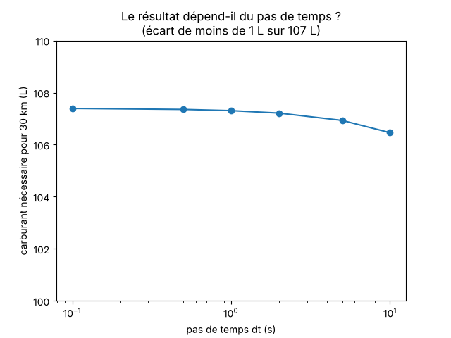
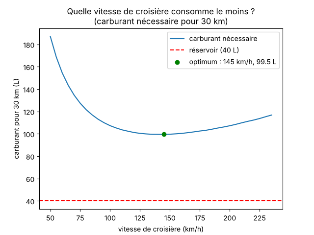
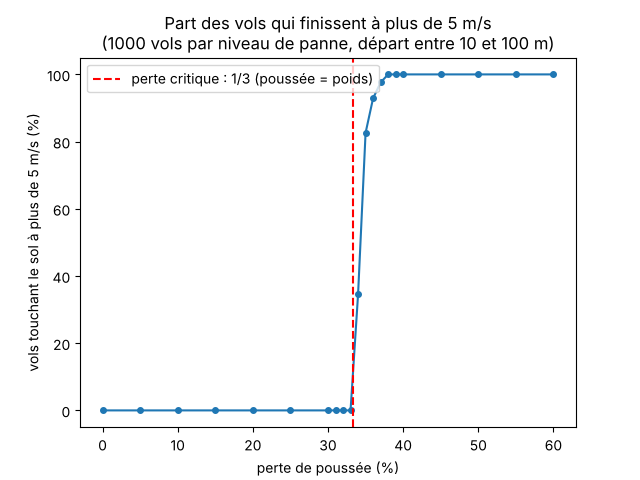
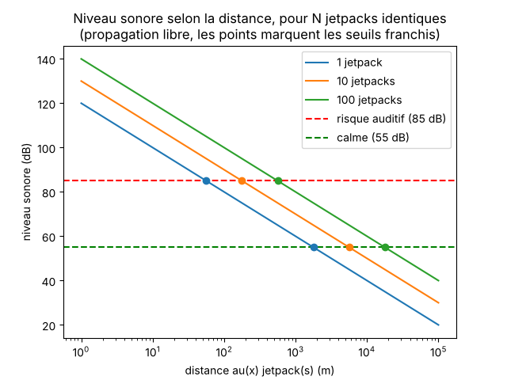

# Venir à l'IUT en jetpack ? Que faudrait-il sacrifier en coût, en temps et en sécurité ?

> Lundi, 8 h 12. On est en retard. Et si on prenait le jetpack ?

## Pourquoi ce sujet

Ce projet reprend le sujet du **grand oral de physique-chimie** d'Éline Iciakhene
(« Le jetpack pourrait-il devenir un moyen de transport de la vie de tous les
jours ? »). Le sujet étant conséquent, nous nous sommes appuyées sur ses
recherches, ses calculs et ses questionnements pour être plus productives.

Éline avait conclu « probablement non » avec des calculs à la main et des
valeurs fixes. Ici, on refait l'étude **avec du code**, pour 30 km
(maison → IUT), et on vérifie si la conclusion tient toujours.

## Lien avec le module

- **Recherche de racines (TP3)** : une dichotomie trouve le volume de carburant qui donne exactement 30 km.
- **Calcul numérique et erreur (TP1)** : on mesure l'effet du pas de temps `dt` sur le résultat.
- **Vérification par une propriété** : `math.isclose` et `assert` vérifient qu'on retombe bien sur le seuil de bruit et sur le résultat de la partie 1.

Nous n'utilisons pas les matrices ni la géométrie du plan : le sujet n'en a pas besoin.

## Les données de départ

| Donnée | Valeur | Origine |
|---|---|---|
| Masse pilote + jetpack | 120 kg | grand oral |
| Poussée pour 1,5 g ressenti | 1 800 N | grand oral |
| Consommation | 4 à 5 L/min (on prend 4,5) | grand oral |
| Réservoir | 40 L, soit 8 à 10 min | grand oral |
| Vitesse de croisière / max | 100 km/h / 235 km/h | grand oral |
| Prix du carburant | 80 € pour 40 L, soit 2 €/L | grand oral |
| Bruit | 120 dB près de l'appareil, supposés **mesurés à 1 m** | grand oral + hypothèse |
| Distance maison → IUT | 30 km | grand oral |
| Masse volumique du carburant | 0,8 kg/L (kérosène) | hypothèse |
| Voiture, pour comparer | 30 min, 7 € | hypothèse |

Les données issues du grand oral se basent sur des jetpacks réels, comme celui
de Franky Zapata ou le Martin Jetpack. Elles ont été reprises et vérifiées par
May Hlaoui. Les lignes marquées « hypothèse » sont de nous, et toutes les
hypothèses sont rassemblées en fin de document.

## Comment lancer (depuis le dossier outilFonda)

```
python3 -m pip install matplotlib
python3 projet/jetpack.py     # partie 1
python3 projet/vitesse.py     # partie 2
python3 projet/pannes.py      # partie 3
python3 projet/bruit.py       # partie 4
python3 projet/duel.py        # partie 5
```
Les parties 1 à 4 affichent leurs résultats et enregistrent leur graphique
(`.png`) dans `projet/`. La partie 5 affiche seulement un tableau.

## Partie 1 : combien de carburant pour 30 km ? (`jetpack.py`)

Le piège : plus on emporte de carburant, plus on est lourd, donc plus on en
brûle. On ne peut donc pas diviser simplement 30 km par la consommation.
Le programme fait voler le jetpack seconde par seconde (la masse baisse à
mesure que le réservoir se vide), et une **dichotomie** cherche le volume de
départ qui donne exactement 30 km.

**Résultat : environ 107 L**, soit presque 3 fois le réservoir de 40 L.

Test de cohérence : pour 16 km (la distance que l'oral associait à 40 L), le
modèle donne **≈ 50 L** et non 40 L (essai fait en changeant `DISTANCE` dans
`jetpack.py`). L'écart vient du poids du carburant, que le calcul à la main de
l'oral ne prenait pas en compte : avec 40 L, le modèle ne permet de faire
qu'environ 13 km.



Effet du pas `dt` : de 106,46 L (dt = 10 s) à 107,39 L (dt = 0,1 s), soit
moins de 1 L d'écart. Le graphique est tracé à l'échelle : la courbe est
presque plate. La simulation **sous-estime** un peu avec un gros pas, car le
dernier pas est compté en entier même si le réservoir se vide avant.
`dt = 1 s` suffit.

## Partie 2 : existe-t-il une vitesse idéale ? (`vitesse.py`)

À basse vitesse on vole longtemps (beaucoup de carburant pour rester en l'air),
à haute vitesse l'air freine (frottement en v²). Il y a donc un minimum.

**Hypothèse (ajoutée par nous, pas dans l'oral)** : à 100 km/h, 2/3 de la
consommation sert à tenir en l'air et 1/3 à vaincre l'air.



**Résultat :** le minimum est à environ **145 km/h (à 5 km/h près), avec
99,5 L**. Même à la meilleure vitesse, il faut 2,5 fois le réservoir. Aucune
vitesse ne permet de faire 30 km avec 40 L. À 235 km/h c'est pire (117 L) : le
frottement domine. À 100 km/h, le script retrouve bien les 107 L de la partie 1
(vérifié par un `assert`).

Limite : la position du minimum dépend de notre hypothèse 2/3 – 1/3
(`PART_VOL`). Avec 0,5 l'optimum passe à 100 km/h (107 L) et avec 0,8 à
200 km/h (81 L), en changeant `PART_VOL` à la main. L'optimum bouge beaucoup,
mais la conclusion « 40 L ne suffisent jamais » reste vraie.

## Partie 3 : le risque, si le moteur perd de la poussée (`pannes.py`)

Scénario : le pilote est immobile à une hauteur tirée au hasard entre 10 et
100 m. Le moteur perd un pourcentage de poussée. Pendant 1 s il ne réagit pas,
puis il met les gaz à fond (1 800 N, amputés de la panne). On compte les vols
qui touchent le sol à plus de 5 m/s. Ce seuil de blessure grave est une
**hypothèse de notre modèle** (environ l'équivalent d'une chute de 1,25 m),
pas une donnée sourcée. 1000 vols par niveau de panne, `random.seed(42)`, avec
un pas de 1 % entre 30 et 40 % pour bien voir la bascule.



**Résultat :** 0 % de crash jusqu'à 33 % de perte, puis **34,5 % à 34 %**,
**82,6 % à 35 %** et 100 % à partir de 38 %. La bascule est brutale et vient
de la physique : poussée max (1 800 N) × (1 − p) doit dépasser le poids
(1 200 N), soit p < 1/3. Au-delà, le pilote ne peut plus arrêter sa chute.
Elle n'est pas pour autant toujours dangereuse : à 35 %, seuls les vols partis
de plus d'environ 27 m dépassent 5 m/s, car en dessous le sol arrive avant.

Limites : poussée de pointe supposée disponible, pas de frottement, délai de
réaction de 1 s supposé, panne instantanée et constante. Le script vérifie
aussi que le pas `dt` change peu la vitesse d'impact (10,58 m/s à dt = 0,01 s
contre 10,583 à dt = 0,001 s).

## Partie 4 : le bruit (`bruit.py`)

Modèle : 120 dB à 1 m (hypothèse sur la distance de mesure), +10·log₁₀(N)
pour N jetpacks, −6 dB à chaque doublement de la distance.

Seuils utilisés : 85 dB(A), valeur d'exposition haute du Code du travail pour
8 h ; 55 dB(A), ordre de grandeur de l'OMS pour la gêne en extérieur en journée.
Notre modèle calcule des dB, sans pondération (A) : l'ordre de grandeur reste
valable, pas la précision.



| Jetpacks | À 1 m | Sous 85 dB (risque auditif) | Sous 55 dB (calme) |
|---|---|---|---|
| 1 | 120 dB | 56 m | 1,8 km |
| 10 | 130 dB | 178 m | 5,6 km |
| 100 | 140 dB | 562 m | 17,8 km |

On retrouve le « 140 dB » de l'oral pour 100 jetpacks, mais c'est une simple
conséquence de notre modèle, pas une vérification indépendante. On ajoute ce
que l'oral ne disait pas : **un seul jetpack** dépasse déjà le seuil de calme
à près de 2 km.
Limites : pas d'absorption de l'air, pas de bâtiments.

## Partie 5 : le duel (`duel.py`)

| | Temps | Carburant | Coût |
|---|---|---|---|
| Voiture | 30 min | n/a | 7 € |
| Jetpack 100 km/h | 18,0 min | 107 L | 215 € |
| Jetpack 140 km/h | 12,9 min | 100 L | 199 € |
| Jetpack 235 km/h | 7,7 min | 117 L | 234 € |

Le coût est le carburant seul, à 2 €/L. Les 30 min et 7 € de la voiture sont
une hypothèse de notre part.

## Verdict

**Non, pas tel que modélisé.**
- **Temps** : on gagne jusqu'à 22 min à 235 km/h (7,7 min au lieu de 30), mais
  on ne peut pas faire le trajet : il faut ≈ 100 L et le réservoir en fait 40.
- **Coût** : environ 200 € par aller, contre 7 € pour la voiture.
- **Sécurité** : au-delà d'un tiers de poussée perdue, la chute ne peut plus
  être arrêtée ; à 35 % de perte, 83 % des vols finissent à plus de 5 m/s.
- **Tranquillité** : un seul jetpack est audible à près de 2 km, et 100
  jetpacks à près de 18 km.

Le projet confirme la conclusion de l'oral, avec des chiffres : même en
cherchant la meilleure vitesse, 30 km dépassent de loin le jetpack décrit.

## Hypothèses et limites

Vitesse constante, pas de vent, pas de montée ni de descente dans la partie
carburant, consommation proportionnelle à la masse, masse volumique du
carburant 0,8 kg/L, partage 2/3 – 1/3 de la consommation (inventé), seuil de
blessure (5 m/s) et délai de réaction (1 s) supposés, bruit de 120 dB mesuré à
1 m, voiture à 30 min et 7 €, valeurs issues d'un oral de lycée.

## Qui a fait quoi

- Éline : parties 1 et 2
- May : parties 3 et 4
- Ensemble : partie 5, README, tests.

## Usage de l'IA

Nous avons utilisé Claude pour structurer le projet, écrire le code de départ
des parties 2 à 5, rendre le code plus lisible avec des
commentaires. Il a aussi servi
à une relecture finale de la cohérence entre le code, le README et les
graphiques (les scripts ont été relancés et les chiffres comparés).

Ce que nous avons vérifié nous-mêmes :
- Nous avons testé 16 km : le modèle donne ≈ 50 L, alors que la première
  version du README annonçait ≈ 40 L. Nous avons corrigé, et expliqué l'écart
  par le poids du carburant, que l'oral ignorait.
- Nous avons changé `PART_VOL` (0,5 puis 0,8)  sans que la conclusion « 40 L ne suffisent jamais » change.
- Nous avons relu le README, corrigé le verdict sur le temps gagné et les
  fautes de la première version.
